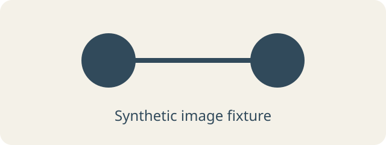

# Oncology 101 — synthetic CI fixture

This page is synthetic software test data. It exercises the education reader,
search, image loading, and the boundary between public education and gated
navigation. It contains no patient information or clinical guidance.

## Search and image fixture

The word **immunotherapy** is a deterministic search token for this fixture.
It is not a treatment recommendation or a scientific claim.

The illustration is an original abstract fixture, not a biological model.
